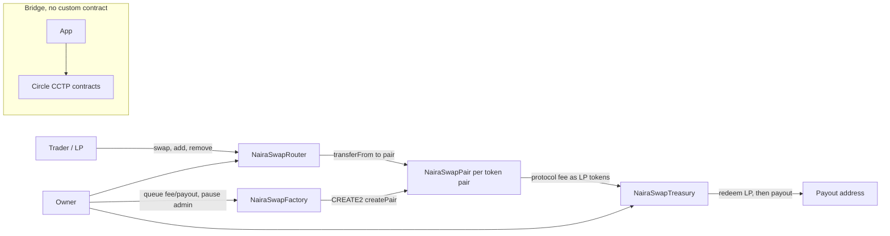

# NairaSwap: Swap Exchange, Liquidity Pools and Treasury (design doc)

## 1. Metadata

| Field | Value |
| --- | --- |
| Status | Draft, awaiting your confirmation |
| Authors | Arc Studio |
| Target chains | Arc Testnet (5042002), Ethereum Sepolia (11155111), Base Sepolia (84532). Testnet only. |
| Language / toolchain | Solidity 0.8.28 (checked arithmetic), Foundry, OpenZeppelin 5.6.1, EVM `cancun` (matches `foundry.toml`) |
| Contracts | `NairaSwapFactory`, `NairaSwapPair`, `NairaSwapRouter`, `NairaSwapTreasury` |
| Bridge | No custom contract. Circle CCTP (Circle's own audited contracts) moves USDC; the app signs the transfer. See section 9. |

Review tracker: [ ] Design  [ ] Security  [ ] Ops  (Data and Compliance: N/A, testnet, no personal data onchain)

## 2. Action items (living)

- Owner and treasury payout address: not yet provided. Asked for again right before deploy. The shared Arc Studio test deployer is never used as owner or fee recipient.

## 3. Goals / Non-goals

Goals
- A constant-product swap exchange you own, with pools for any pair of ERC-20 tokens, LP tokens for liquidity providers, and a treasury that collects a protocol fee.
- Swap fee 0.30% per trade: 0.25% stays in the pool for liquidity providers, 0.05% goes to the treasury.
- Users sign from the app's built-in wallet (PIN) or their browser wallet.
- Fee and treasury changes take effect only after a 2-day delay. Contracts cannot be upgraded. The owner can pause swaps on the router in an emergency, and users can always remove their liquidity.
- Same contract set deployed on all three testnets.

Non-goals
- No custom bridge contract (CCTP is used instead).
- No native-coin (ETH or native USDC) router paths. Users swap ERC-20 tokens. Arc's native USDC is available as the ERC-20 USDC interface, so nothing is lost there.
- No governance token, no farming rewards, no price oracle use inside the contracts, no concentrated liquidity, no flash swaps (the pair has no borrow-and-repay callback, which removes a whole class of reentrancy risk). The pair keeps cumulative price accumulators because integrators expect them.
- No mainnet deployment. Not a substitute for an independent audit.

## 4. Requirements

Functional
- F1 Anyone can create a pair for two distinct ERC-20 tokens once (`createPair`), at a deterministic address.
- F2 Add liquidity to a pair (creating the pair first if needed) and receive LP tokens; remove liquidity by burning LP tokens.
- F3 Swap exact-in or exact-out through one or more pairs, with a minimum-out or maximum-in and a deadline.
- F4 Exact-in swaps also work with fee-on-transfer tokens.
- F5 The treasury receives 1/6 of the 0.30% fee (0.05% of trade value) as LP tokens, and the owner can redeem them for the underlying tokens and send them to the payout address.
- F6 Owner can queue a new fee recipient (factory) or payout address (treasury); it applies no sooner than 2 days later, and the owner can cancel while queued.
- F7 A pauser can pause router swaps and liquidity adds; the owner can unpause. Removing liquidity is never blocked by the router pause.

Security (each is a test assertion)
- S1 No path lets a pair's constant-product value `k` decrease after a swap (fee included).
- S2 Only the factory can initialise a pair, and only once.
- S3 No non-owner can change fee recipient, payout address, pauser or ownership.
- S4 Fee and payout changes cannot apply before the 2-day delay and cannot be applied by a non-owner or twice.
- S5 The router holds no tokens between transactions.
- S6 Reentrancy cannot extract value from a pair (lock on `mint`, `burn`, `swap`, `skim`, `sync`).
- S7 Pause never blocks `removeLiquidity`.
- S8 First liquidity provider cannot be griefed by a donation-inflated price (1000 LP units are permanently locked).
- S9 No function can be called with an expired deadline.
- S10 Ownership cannot be renounced.

## 5. Terminology and actors

Terms: pair (pool of two tokens), LP token (ERC-20 receipt for a share of a pair), reserve, `k` (product of the two reserves), slippage (price movement between quote and execution), protocol fee (the treasury's 0.05%).

| Actor | Onchain/offchain | Trust | Can do |
| --- | --- | --- | --- |
| Trader / liquidity provider | Onchain wallet (in-app wallet or browser wallet) | Untrusted | Swap, add and remove liquidity, create pairs |
| Owner (your address) | Onchain | Trusted, can only change what is listed in section 10 | Queue and apply fee/payout changes, set pauser, unpause, rescue stray tokens, redeem treasury LP |
| Pauser | Onchain | Semi-trusted (pause only) | Pause the router |
| Token contracts | Onchain | Untrusted (may be fee-on-transfer, blocklisting or reverting) | n/a |
| Arc Studio app server | Offchain | Trusted for signing on behalf of in-app wallet users after PIN | Builds and signs transactions the user confirmed |
| Circle CCTP contracts | Onchain | Trusted external dependency (bridge only) | Burn and mint USDC across chains |

## 6. Language / runtime

- Solidity 0.8.28 for checked arithmetic. The only `unchecked` areas are the cumulative price accumulators (overflow is intended and standard) and loop counters, each commented.
- EVM `cancun`. Arc targets a newer baseline; contracts avoid opcodes newer than Cancun and are run on a local Foundry EVM and a fork of each chain before live deploy.
- Based on the Uniswap V2 design (constant product, factory/pair/router split). Preserved: invariant maths, 0.3% fee, `feeTo` protocol-fee mint, TWAP accumulators, permit on LP tokens. Removed: the flash-swap callback. Changed: Solidity 0.8 with OpenZeppelin (`ERC20`, `ERC20Permit`, `SafeERC20`, `Ownable2Step`, `ReentrancyGuard`), ETH paths removed, custom errors, owner-controlled pause on the router, 2-day delay on `feeTo`.
- Libraries: OpenZeppelin 5.6.1 (already a dependency, widely reviewed).

## 7. Transaction and execution model

Each call is atomic. External calls and re-entry surface:
- Pair `swap`/`mint`/`burn` call token `transfer`. Mitigation: reentrancy lock on all state-changing pair functions, reserves updated after balances are read, constant-product check last.
- Router calls tokens (`transferFrom` into pairs) and pairs. It follows checks-effects-interactions, holds no balances, and uses `SafeERC20`.
- Treasury calls pair `burn` and token `transfer`. `nonReentrant`.

## 8. Chain standards and interfaces

- ERC-20 for LP tokens, plus ERC-2612 permit (`ERC20Permit`) so liquidity can be removed with one signature.
- LP permit is ERC-2612 for externally owned accounts (OpenZeppelin ERC20Permit). Contract wallets use a normal approval followed by removeLiquidity; EIP-1271 permits are out of scope.
- Pair, factory and router interfaces mirror the Uniswap V2 function names so existing tooling and the app's current read module work (`getReserves`, `getPair`, `allPairs`, `getAmountsOut`, ...).
- Arc: the ERC-20 USDC at the system address uses 6 decimals while native USDC uses 18; pairs only see the ERC-20 form. USDC and EURC may revert transfers for blocklisted addresses; a revert reverts the whole swap.
- CCTP (bridge): `depositForBurn` on the source chain, Circle attestation, `receiveMessage` on the destination chain. Used through Circle's bridge kit. Addresses are taken from Circle's docs at integration time, not from memory.

## 9. Architecture overview

Deployment order per chain: Treasury (owner, payout) -> Factory (owner, treasury as initial `feeTo`) -> Router (factory, owner, pauser).

Flow of funds

| Step | Who moves what | Invariant |
| --- | --- | --- |
| Add liquidity | LP's tokens -> pair (router `transferFrom`), pair mints LP tokens to LP | LP gets shares proportional to value added; 1000 units locked on first mint |
| Swap | Trader's input token -> first pair; pairs forward output to the recipient | `k` after swap (fee-adjusted) is at least `k` before |
| Protocol fee | On the next mint/burn, pair mints LP tokens to the treasury worth 1/6 of fee growth | Only when `feeTo` is set; LP share of the fee stays 0.25% |
| Remove liquidity | LP burns LP tokens -> pair sends both tokens to the LP | Payout is proportional to share; never blocked by pause |
| Treasury redeem | Owner redeems treasury LP tokens at the pair -> tokens to the treasury -> owner sends to payout address | Only the owner moves treasury funds, only to the payout address |

Resting-state invariants: the router holds no tokens; a pair holds exactly its reserves (plus any unsynced donations that anyone can `skim`); the factory holds nothing; the treasury holds only LP tokens and redeemed fees awaiting withdrawal.

Dependencies and assumptions: ERC-20 behaviour of listed tokens; chain finality; the app server signs only what the user confirmed with a PIN (in-app wallet) or their browser wallet; Circle's CCTP service for the bridge.

## 10. Contract design

### Roles

| Role | Holder | Permissions | Why |
| --- | --- | --- | --- |
| Owner (`Ownable2Step`) on Factory, Router, Treasury | Your address (to be provided) | Factory: queue/cancel/apply `feeTo` change. Router: set pauser, unpause, rescue stray tokens. Treasury: queue/cancel/apply payout change, redeem LP, withdraw to payout. Two-step transfer, no renounce. | Single accountable operator, delayed on money-routing changes |
| Pauser | Initially the owner; settable | Router: pause only | Least privilege emergency stop |
| Anyone | n/a | Create pairs, swap, add/remove liquidity, `skim`, `sync`, apply a queued change once its delay passed (owner-only to queue) | Permissionless exchange |

### Storage layout (non-upgradeable; no proxies, no `__gap` needed)

- `NairaSwapFactory`: `address owner` (Ownable2Step), `address feeTo`, `address pendingFeeTo`, `uint256 pendingFeeToAt`, `mapping(address => mapping(address => address)) getPair`, `address[] allPairs`.
- `NairaSwapPair`: `address immutable factory`, `address token0`, `address token1` (set once), `uint112 reserve0`, `uint112 reserve1`, `uint32 blockTimestampLast`, `uint256 price0CumulativeLast`, `uint256 price1CumulativeLast`, `uint256 kLast`, `uint256 unlocked` (reentrancy lock); inherits OZ `ERC20Permit` (name `NairaSwap LP`, symbol `NSWAP-LP`).
- `NairaSwapRouter`: `address immutable factory`, `bool paused`, `address pauser`; owner via Ownable2Step.
- `NairaSwapTreasury`: `address payout`, `address pendingPayout`, `uint256 pendingPayoutAt`; owner via Ownable2Step.

Constants: `MINIMUM_LIQUIDITY = 1000`, swap fee 30 bps in the pair's invariant check (997/1000), `DELAY = 2 days`, `MAX_PATH = 4` hops.

### Modifiers

| Modifier | Guard |
| --- | --- |
| `onlyOwner` | OZ ownership |
| `onlyPauser` | caller is pauser or owner |
| `whenNotPaused` | router `paused == false` (swap and addLiquidity only) |
| `ensure(deadline)` | `block.timestamp <= deadline` |
| `lock` / `nonReentrant` | pair and treasury reentrancy guard |

### Functions (writes)

Factory
- `createPair(tokenA, tokenB)`: anyone; reverts on identical tokens, zero address, existing pair; deploys the pair with CREATE2 and initialises it; emits `PairCreated`.
- `queueFeeTo(address)`: owner; stores pending value and `now + 2 days`; emits `FeeToQueued`.
- `applyFeeTo()`: owner; reverts if nothing queued or delay not elapsed; sets `feeTo`; emits `FeeToSet`.
- `cancelFeeTo()`: owner; emits `FeeToCanceled`.

Pair
- `initialize(token0, token1)`: factory only, once.
- `mint(to)`: after tokens are sent in; mints LP, locks 1000 on first mint; mints protocol-fee LP to `feeTo` first when set; emits `Mint`, `Sync`.
- `burn(to)`: LP tokens sent in first; pays both tokens pro rata; emits `Burn`, `Sync`.
- `swap(amount0Out, amount1Out, to, data)`: sends outputs (the data argument must be empty), then enforces the fee-adjusted invariant; reverts on insufficient output, insufficient input, invalid `to`; emits `Swap`, `Sync`.
- `skim(to)`, `sync()`: anyone; align balances and reserves.

Router (all take `deadline`; swap/add also `whenNotPaused`)
- `addLiquidity(tokenA, tokenB, amountADesired, amountBDesired, amountAMin, amountBMin, to, deadline)`: creates the pair if missing, computes optimal amounts, reverts below the minimums.
- `removeLiquidity(tokenA, tokenB, liquidity, amountAMin, amountBMin, to, deadline)` and `removeLiquidityWithPermit(...)`: never paused.
- `swapExactTokensForTokens(amountIn, amountOutMin, path, to, deadline)`, `swapTokensForExactTokens(amountOut, amountInMax, path, to, deadline)`, and `swapExactTokensForTokensSupportingFeeOnTransferTokens(...)`.
- `pause()` (pauser), `unpause()` (owner), `setPauser(address)` (owner), `rescueTokens(token, to, amount)` (owner).

Treasury
- `queuePayout(address)`, `applyPayout()`, `cancelPayout()`: owner, 2-day delay, same rules as the factory.
- `redeem(pair, liquidity)`: owner; burns the treasury's LP tokens at the pair, tokens land in the treasury.
- `withdraw(token, amount)`: owner; sends only to `payout`.

Reads: `getReserves`, `getAmountsOut`, `getAmountsIn`, `quote`, `getPair`, `allPairsLength`, `paused`, `payout`, `feeTo`, pending values.

Revert conditions use custom errors: `Expired`, `IdenticalAddresses`, `ZeroAddress`, `PairExists`, `InsufficientLiquidity`, `InsufficientInputAmount`, `InsufficientOutputAmount`, `ExcessiveInputAmount`, `InvalidPath`, `Paused`, `DelayNotElapsed`, `NothingQueued`, `Forbidden`, `InvalidTo`, `Locked`.

### Events

| Event | Params | When |
| --- | --- | --- |
| `PairCreated` | token0 (indexed), token1 (indexed), pair, index | pair created |
| `Mint`, `Burn`, `Swap`, `Sync` | standard V2 params | pair actions (index the sender and `to`) |
| `FeeToQueued` / `FeeToSet` / `FeeToCanceled` | new value, applyAt | factory fee recipient changes |
| `PayoutQueued` / `PayoutSet` / `PayoutCanceled` | new value, applyAt | treasury payout changes |
| `Paused` / `Unpaused` / `PauserSet` | account | router control |
| `Redeemed` / `Withdrawn` | pair or token, amount, to | treasury movements |

## 11. Specification tables

Fee and treasury

| Functionality | Restriction | Note | Event | Chain-specific adjustment | Verify note |
| --- | --- | --- | --- | --- | --- |
| Swap fee | Fixed in code | 0.30% of input, enforced by the invariant check | `Swap` | | Fuzz: `k` never falls |
| Protocol fee | `feeTo` set | 1/6 of fee growth minted as LP to `feeTo` | `Mint`/`Transfer` | | Equals 0.05% of volume within rounding |
| Change `feeTo` | Owner, 2-day delay | queue, then apply | `FeeToQueued`, `FeeToSet` | | Test early apply reverts |
| Change payout | Owner, 2-day delay | queue, then apply | `PayoutQueued`, `PayoutSet` | | Same |
| Pause | Pauser/owner | blocks swaps and adds only | `Paused` | | `removeLiquidity` still works |

## 12. Deployment and initialization

- Per chain, from the same owner key, in this order: Treasury, Factory, Router. Constructor arguments: Treasury `(owner, payout)`, Factory `(owner, treasury)`, Router `(factory, owner, pauser)`.
- Addresses are not forced to match across chains (no CREATE2 factory for these; each pair address is deterministic per factory).
- Genesis: owner holds ownership, `feeTo` is the treasury, payout is the owner-provided payout address, pauser is the owner. Minimum balance after deploy: none held by any contract.
- Runbook: deploy the three contracts, verify code at each address, create one test pair, add a small amount of liquidity, swap, remove, confirm the treasury received LP tokens. Record all addresses in `AGENTS.md` and `.env` (as `NAIRASWAP_*` variables per chain).

## 13. Upgradeability

None. Contracts are immutable. Migration story: contract switch. Deploy a new factory and router, move liquidity (LPs remove from the old pairs and add to the new), and re-point the app's addresses. The old contracts keep working so users can always exit.

## 14. Key management and signing

- Owner key: the address you provide; should be a hardware wallet or multisig in production. Compromise impact in section 16.
- Users sign with their in-app wallet (server signs after PIN, PIN-lockout and per-user limits apply) or with their browser wallet (they sign directly; the server never sees their key).
- LP permit uses EIP-712 with nonce, deadline, domain separator and chainId from OpenZeppelin. Swaps use a deadline and minimum-out.
- Exact-amount token approvals only (no unlimited approvals), set in the same flow as the swap.

## 15. Security considerations

| Vulnerability | Applicable? | Mitigation |
| --- | --- | --- |
| Reentrancy | Yes (token callbacks) | Lock on all pair writes, CEI, `nonReentrant` on treasury, router holds no balances |
| Access control | Yes | Section 10 role table; every privileged function listed; Ownable2Step |
| Integer overflow | Checked | `unchecked` only for price accumulators and counters, commented |
| Unchecked external call/return | Yes | `SafeERC20` in router and treasury; pair uses low-level safe transfer that checks the return |
| Fee-on-transfer / rebasing tokens | Yes | Pair measures received amounts from balances; supporting-fee router variant for exact-in; rebasing tokens documented as unsupported (`sync`/`skim` exist) |
| Signature replay | LP permit only | OZ nonce + deadline + domain + chainId |
| Front-running / MEV | Yes | Slippage minimums and deadlines on every router call; app defaults 1% and 10 minutes |
| Flash-loan / price manipulation | Spot reserves are manipulable | No contract here consumes the spot price; TWAP accumulators provided for integrators; docs warn not to use spot as an oracle |
| Oracle manipulation | N/A | No oracle consumed |
| Denial of service | Yes | Bounded paths (max 4 hops), no unbounded loops over pairs, pull-based payouts |
| Delegatecall / proxy safety | N/A | No proxies, no delegatecall |
| Timestamp dependence | Delay timers and deadlines | 2-day delay and minute-scale deadlines tolerate validator skew; not used for randomness |
| Approval persistence | Yes | Exact-amount approvals from the app; router never keeps allowances |
| Centralization risk | Yes | Delay on fee/payout changes, pause cannot block exits, owner cannot touch pool funds or LP tokens of users |
| First-depositor inflation | Yes | 1000 LP units locked forever |
| Pair address squatting / fake pairs | Yes | Pairs only created by the factory; app only lists pairs from the factory and shows token symbols with addresses |
| Malicious tokens in a pair | Yes | Only that pair is affected; the app warns on unverified tokens (existing registry check) |
| Blocklisted / reverting USDC or EURC | Yes | The whole transaction reverts; no partial state |

## 16. Trust model and threat analysis

| Privileged actor | Worst case if the key is compromised | Mitigation | Detection |
| --- | --- | --- | --- |
| Owner | Queues a new `feeTo` or payout address (takes 2 days to apply), pauses swaps (via pauser), withdraws treasury-held fees. Cannot move user liquidity or user tokens, cannot change the 0.30% fee, cannot upgrade. | 2-day delay and cancel window, two-step ownership transfer, no renounce, hardware wallet or multisig | `FeeToQueued`, `PayoutQueued`, `OwnershipTransferStarted` alerts |
| Pauser | Pauses swaps and liquidity adds (not exits) until the owner unpauses | Pause only, owner can replace the pauser | `Paused` alert |
| App server signer | Could sign for in-app users only after a valid PIN session; blast radius is that user's own wallet | PIN lockout, per-token limits, audit log | Existing alerts and audit log |

## 17. Emergency response and circuit breakers

- Pause: pauser pauses the router; unpausing is owner-only. Pairs are permissionless and cannot be paused, so the pause protects app and router users, not people calling pairs directly. This is a deliberate trade-off for immutability.
- Exits: `removeLiquidity` works while paused.
- Rescue: owner can recover stray tokens sent to the router or treasury, never pool reserves.
- Playbook: (1) pause, (2) cancel any queued owner change not made by you, (3) rotate the owner via two-step transfer if the key is suspect, (4) publish the incident, (5) deploy a new version if needed (section 13).

## 18. Failure scenarios

- A token reverts mid-swap: the whole transaction reverts; reserves unchanged.
- A multi-hop swap fails at hop 3: all hops revert (single transaction).
- Treasury redeem when the pair has no liquidity: reverts with `InsufficientLiquidity`; LP tokens stay in the treasury.
- A donation to a pair changes its balance but not its reserves: the next swap/mint is priced from reserves; `skim` or `sync` aligns them. The invariant check is computed from balances, so the donor cannot extract value.
- Owner queues a change, then the key is lost: nothing applies unless the owner calls `apply`; the queued change is harmless until then.
- CCTP attestation is delayed: the bridge transfer stays "pending" in the app; funds are not lost and can be completed later on the destination chain.

## 19. Priorities and tradeoffs

| Decision | Tradeoff | Rationale / rejected alternative |
| --- | --- | --- |
| Uniswap V2 design | Less capital-efficient than V3 | Smallest audited-pattern surface; rejected V3 (complexity) |
| Immutable contracts | No bug-fix upgrades | Users trust code that cannot change; rejected UUPS proxy |
| Router-only pause | Pairs stay callable | Keeps pairs trustless; exits always available |
| 2-day delay only on fee recipient and payout | Pause is instant | Pause must be fast; money-routing changes must be slow |
| No ETH paths | Users wrap native tokens first | Avoids Arc's 18 vs 6 decimal native/ERC-20 mismatch and WETH placeholder issues |
| CCTP for the bridge | USDC only, Circle attestation wait | A custom lock-and-mint bridge would hold user funds behind a trusted relayer; rejected |
| Deterministic pair addresses via CREATE2 | Needs the init code hash in the router | Standard and cheap to verify |

## 20. Testing strategy

- Foundry unit tests for every function and revert, events, permit, delay timers, two-step ownership, pause (including exits while paused).
- Fuzz: swap amounts (`k` never decreases), add/remove round trips (no value created), path lengths, fee-on-transfer mock.
- Invariants: LP total supply equals the sum of balances; reserves always at most balances; the router balance is zero after any call sequence.
- Fork tests on Arc Testnet against real USDC and EURC (transfer, blocklist behaviour).
- Static analysis: Slither. Coverage target: 95% branches on the four contracts.
- Gates before deploy: all tests pass, security review clean, fork verification pass.
- Command: `forge test -vv` (and `forge coverage`).

## 21. Third-party libraries

| Library | Version | Already a dependency? | Why | Reviewed? |
| --- | --- | --- | --- | --- |
| OpenZeppelin Contracts | 5.6.1 | Yes | ERC20, Permit, SafeERC20, Ownable2Step, ReentrancyGuard | Widely audited |
| forge-std | repo version | Yes | Tests | n/a |
| Circle bridge kit (`@circle-fin/app-kit`) | repo version | Yes | Bridge through CCTP | Circle-maintained |

## 22. Monitoring and alerting

| Event / metric | Threshold | Severity | Playbook |
| --- | --- | --- | --- |
| `FeeToQueued`, `PayoutQueued` | any | Critical | Confirm it was you; otherwise cancel |
| `OwnershipTransferStarted` | any | High | Confirm |
| `Paused` | any | High | Investigate, then unpause |
| Large single swap (over 20% of reserves) | per swap | Medium | Check for manipulation |
| Pair created with an unknown token | any | Low | Registry review |

The app already records alerts and an audit log; the chain monitor will watch these events on all three chains.

## 23. Cross-functional stakeholders

You (owner and product), security review (Arc Studio review pipeline plus your independent audit before any real-money use), app engineering (in-app signing, UI).

## 24. Message encoding

N/A for the exchange (no cross-chain messages in our contracts). The bridge uses Circle's CCTP message format, owned and documented by Circle.

## 25. Types and enums

No structs cross the ABI. Router paths are `address[]`. Queued changes are stored as `(address, uint256 applyAt)` pairs.

## 26. Worked examples

Add liquidity: user approves exactly 100 USDC and 80 EURC to the router, calls `addLiquidity` with 1% slippage and a 10-minute deadline. The router creates the pair if needed, moves both tokens into the pair, the pair mints LP tokens to the user and (if `feeTo` set) a small fee mint to the treasury. Events: `PairCreated` (first time), `Transfer` (LP mint), `Mint`, `Sync`.

Swap: user approves exactly 10 USDC, calls `swapExactTokensForTokens(10 USDC, minEURC, [USDC, EURC], user, deadline)`. The router pulls USDC into the pair, the pair sends EURC to the user after the invariant check. Events: `Swap`, `Sync`, token `Transfer`s.

Bridge: user picks 25 USDC, Arc Testnet to Base Sepolia. The app approves and calls CCTP `depositForBurn` on Arc, waits for Circle's attestation, then calls `receiveMessage` on Base Sepolia, which mints USDC to the user's address there. No NairaSwap contract is involved.

## App integration (not contracts)

- Server: `server/dex/` gains the factory/pair/router/treasury ABIs, quote and pool reads for all three chains, transaction builders, and in-app signing that reuses the existing PIN confirmation, limits, audit log and history.
- Browser wallet: the same transaction builders are signed with wagmi (Connect wallet), on the chain the user selects.
- Screens: an Onchain tab on Swap, a Pools screen (list pools, add and remove liquidity, LP positions), and a real Bridge screen using Circle's bridge kit, replacing the current "no provider connected" result.
- Founder: a treasury panel showing collected LP tokens, queued fee/payout changes (with cancel) and pause state.
